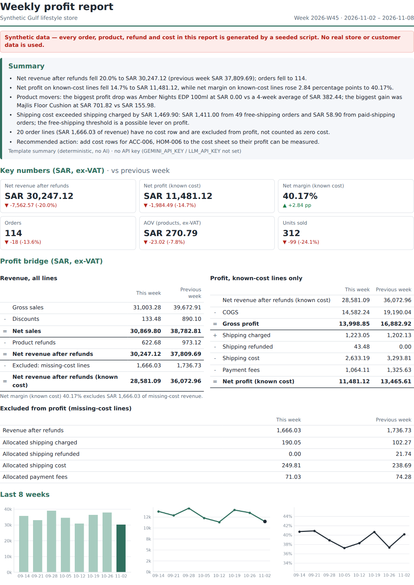
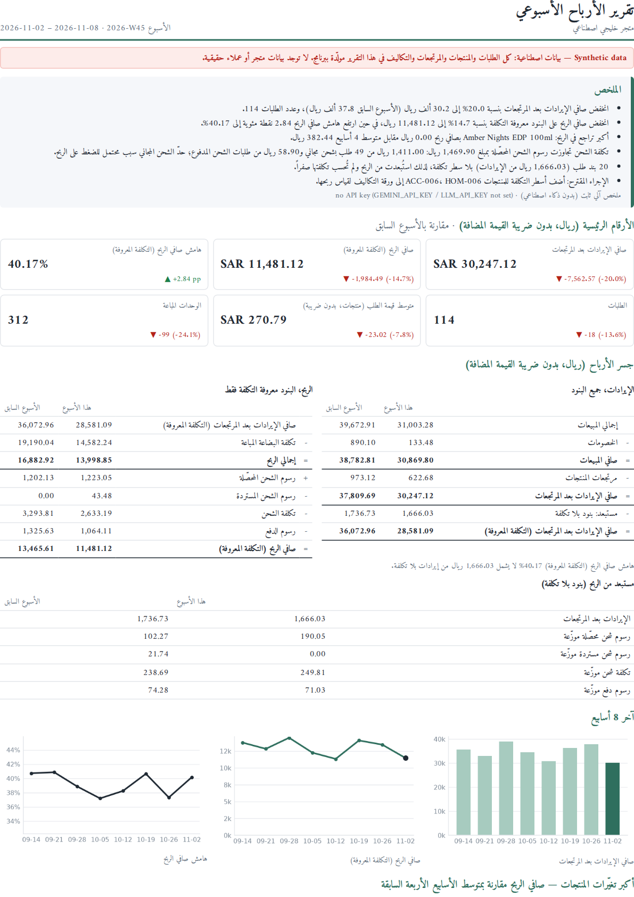

# P3 — E-commerce Profit Reporting

> **⚠️ Synthetic data.** Every product, order, refund and cost in this repository is generated by a seeded
> script (`python -m p3 generate`). No real store, merchant or customer data is used. Every report this
> project produces carries the same notice.

A portfolio project for a freelance service. It connects a store's API and the owner's cost sheet,
computes **true net profit** per order and product, and sends an automated weekly report with an
AI-written summary whose numbers are checked against the data.

| Phase | Scope | Status |
|---|---|---|
| 1 | Scaffold, synthetic data, mock WooCommerce API, incremental ingestion into Postgres, tests | ✅ done |
| 2 | dbt models + tests: profit per order line / order / product / week | ✅ done |
| 3 | Weekly PDF/HTML report, LLM summary with number verification | ✅ done |
| 4 | n8n weekly schedule + email via Mailpit, GitHub Actions CI | planned |

## Architecture (Phase 1)

```
 data/*.json ──► mock store API (FastAPI, WooCommerce-shaped) ──HTTP──┐
                 /wp-json/wc/v3/{products,orders,refunds}             │   python -m p3 ingest
                                                                      ├─► extract ─► validate ─► load (1 txn)
 cost sheet CSV (file path or Google-Sheets CSV URL) ─────────────────┘                     │
                                                                                            ▼
                     PostgreSQL 16 (docker: p3-profit-pg, 127.0.0.1:5436), schema `raw`
                     raw_products · raw_orders · raw_order_lines · raw_refunds · raw_costs
                     etl_runs · etl_rejects · etl_watermarks
```

## Quickstart (from zero)

You need Python 3.12+ and Docker. Nothing is installed system-wide: dependencies go into a project `.venv`.

```bash
python3 -m venv .venv && .venv/bin/pip install -e '.[dev]'
python3 scripts/setup_env.py                 # .env with random secrets (never overwrites)
docker compose up -d --wait                  # Postgres 16 -> 127.0.0.1:5436
.venv/bin/python -m p3 generate              # deterministic synthetic data -> data/
.venv/bin/python -m p3 init-db               # raw schema (idempotent)
.venv/bin/python -m p3 serve &               # mock store API on 127.0.0.1:8008 (or in a 2nd terminal)
.venv/bin/python -m p3 ingest                # run twice: the 2nd run upserts 0 rows
.venv/bin/python -m pytest                   # uses the separate p3_test database
.venv/bin/python -m p3 summary               # counts, rejects, runs, watermarks, missing-cost SKUs
.venv/bin/python -m p3 dbt build             # Phase 2: profit models + all dbt tests (database p3)
.venv/bin/python -m p3 profit-summary        # last full week KPIs, top/bottom products, missing-cost warning
.venv/bin/playwright install chromium        # Phase 3, once per user: Chromium for HTML -> PDF
.venv/bin/python -m p3 report                # weekly report: facts.json + report.html + report.pdf
```

`pytest -m "not dbt"` skips the slower dbt tests. The full suite also builds the dbt project against `p3_test`.

Other commands:
- `p3 serve --inject-faults N` serves N orders malformed so you can watch the reject path. It is off by default.
- `p3 init-db --reset` drops and recreates the raw schema.
- `docker compose down -v` destroys the database volume.
- `p3 ingest --cost-source <path|url>` reads the cost sheet from somewhere other than `COST_SHEET_SOURCE`.

Secrets live in `.env`, which is gitignored. `.env.example` documents every variable. If you regenerate
`.env` after the volume exists, run `docker compose down -v` first, because Postgres keeps the old password.

## The synthetic store

- **Store:** a Gulf lifestyle store selling in **SAR**: 40 products in 6 categories (perfumes, bakhoor,
  abayas, coffee & dates, home & majlis, phone accessories).
- **Period:** fixed dates, never "today". Orders run from **2026-05-11 (Mon) to 2026-11-08 (Sun)**,
  26 full weeks, so the last weekly report covers a complete week. The seed is `GEN_SEED`, default 42.
- **Volume:** about 3,050 orders and 7,140 lines.
- **Seasonality:**
  - Thursday and Friday peaks (the Saudi weekend)
  - An evening-heavy time of day
  - A **payday bump around the 27th**
  - Mild growth over the period
  - A **back-to-school promo week, 2026-08-10 to 08-16**, with coupon `BTS20` (20% off)
- **Discounts:** coupons `WELCOME10` and `SAVE15` (the latter on baskets of 400 SAR or more).
- **Shipping:** customers are charged 25 SAR flat, or nothing on baskets of 299 SAR or more. The carrier's cost
  to the store is separate, depends on units and city, and is stored in `meta_data._shipping_cost`.
- **Payment gateway fee:** 2.75% + 1 SAR by default (`PAYMENT_FEE_PCT`, `PAYMENT_FEE_FIXED`), stored in
  `meta_data._payment_gateway_fee`. In real WooCommerce the gateway fee usually comes from the payment
  provider (its payout or balance API), not from the order.
- **Refunds and cancellations:** about 4% of orders are refunded, some fully (status `refunded`) and some
  partially (one unit). About 1% of orders are cancelled, with no fee and no shipping cost.
- **VAT:** Saudi VAT is 15%. Shelf prices are **VAT-inclusive** (`prices_include_tax: true`). As in WooCommerce,
  order and line amounts (`subtotal`, `total`, `shipping_total`, `discount_total`) are **ex-VAT**, and VAT
  sits beside them in `subtotal_tax`, `total_tax`, `shipping_tax` and `discount_tax`. Every tax column
  lands in the raw tables. **Profit is computed ex-VAT** in Phase 2, because VAT collected is owed to
  ZATCA (the Saudi tax authority) and is not revenue.
- **Cost sheet** (`data/costs.csv`, the columns an owner keeps in Google Sheets: `sku, unit_cost,
  packaging_cost, effective_from`). Costs are ex-VAT.
  - 5 SKUs change cost mid-period (`effective_from`).
  - **2 SKUs that sell have no cost row at all** (`ACC-006`, `HOM-006`, launched mid-period). They
    must be flagged downstream and never treated as zero cost.

## Mock store API

The API follows WooCommerce REST v3 at `/wp-json/wc/v3`:
- **Auth:** basic auth with the consumer key and secret from `.env`.
- **Pagination:** `per_page` (max 100) and `page`, with `X-WP-Total`, `X-WP-TotalPages` and `Link` headers.
- **Filters:** `modified_after`, plus `dates_are_gmt`, `orderby` and `order`.
- **Endpoints:** `GET /products`, `GET /orders`, `GET|PUT /orders/{id}` (PUT bumps `date_modified`),
  `GET /orders/{id}/refunds`.

There is one deliberate deviation: **`GET /refunds`** is top-level and filterable by `modified_after`, so refunds
can be pulled incrementally. Real WooCommerce only nests them under each order. Refunds are immutable, so their
"modified" time is `date_created`.

## Ingestion guarantees

- **Incremental:** each entity has a watermark (the max `date_modified_gmt` seen) in `raw.etl_watermarks`.
  The next run asks for `modified_after = watermark − 5 min`.
- **Idempotent:** `payload_hash` is the sha256 of **canonical JSON** (sorted keys), so a change in key order
  is never mistaken for an update. Upserts only rewrite rows whose hash changed, so a re-run reports 0 upserts.
- **One transaction per run:** all raw rows, rejects and watermarks commit together or not at all. Order
  lines are replaced inside the same transaction as their order.
- **Rejects, not crashes:** a malformed record goes to `raw.etl_rejects` with entity, id, reason and the
  raw payload, and the run continues. Order totals must reconcile with the lines plus shipping.
- **Run log:** `raw.etl_runs` records the run id, start and finish times, status, rows
  read/upserted/rejected, per-entity stats and any error.
- **Retries:** transport errors, 429 and 5xx responses retry with exponential backoff (5 attempts). Other 4xx
  errors fail fast.

## Profit models (dbt, Phase 2)

**How dbt runs:** dbt-core 1.12.6 and dbt-postgres 1.11.0 are installed in the project `.venv`. That
pairing already runs on Python 3.14 in a sibling project, so there's no Docker image and nothing
system-wide. `python -m p3 dbt <args>` passes the `.env` credentials as environment variables, and
`dbt/profiles.yml` reads only `env_var(...)`.

**Layers:**
- `staging`: one view per raw table, typed and renamed, plus `stg_refund_lines` unnested from refund JSON.
- `intermediate`:
  - `int_line_costs`: effective-dated cost per line
  - `int_order_allocations`: order amounts split across lines
  - `int_line_refunds`: refund effects per line
  - `int_profit_ledger`: sale and refund events, each dated into a week
- `marts`:
  - `fct_order_lines_profit`
  - `fct_orders_profit`
  - `agg_product_weekly`
  - `agg_weekly_kpis`
  - `dq_issues`

### Accounting rules
1. **Revenue is ex-VAT.** Line net revenue is the WooCommerce line `total`: ex-VAT, after discount.
   Shipping charged is `shipping_total`, also ex-VAT. VAT (15%) is owed to ZATCA, so it is never revenue
   or cost. The `*_tax` columns are used only in reconciliation tests.
2. **Order status.** Only `completed`, `processing` and `refunded` orders count (dbt var
   `revenue_statuses`). Cancelled, failed and pending orders are excluded and listed in `dq_issues`
   as `excluded_order_status`.
3. **Allocation.** Shipping charged, shipping cost and the payment gateway fee are order-level amounts.
   Each is allocated to lines in proportion to line net revenue, using **largest-remainder rounding in
   halalas**: floor every share, then give the leftover halalas to the largest fractional parts (ties go
   to the lowest line id). Allocations therefore sum to the order amount exactly. If every line is free,
   the lines get equal shares. Refunded shipping is allocated per refund in the same way.
4. **COGS** = (unit_cost + packaging_cost) × qty. It uses the cost row with the **latest `effective_from`
   on or before the order date**, in store-local time (var `store_timezone`, default `Asia/Riyadh`).
5. **Refunds** reduce revenue (and refunded shipping reduces shipping charged) in the refund date's week.
   Var `refund_week_basis` takes `refund_date` (the default) or `order_date`. Refunded units go back to
   stock, so their COGS is reversed at the cost used on the original sale. **Payment fees and shipping
   cost are not recovered.**
6. **Missing cost.** A line whose SKU has no applicable cost row gets `cost_missing = true` and
   **NULL** COGS, gross profit and net profit, never zero.
   - **Revenue and fees** totals still include these lines, and so do refunds of them.
   - **Profit and margin** columns cover known-cost lines only, and are suffixed `_known_cost`.
   - **Disclosure:** every mart shows `missing_cost_lines` and `missing_cost_net_revenue_ex_vat`.
   - **Orders:** an order with any missing-cost line has NULL `net_profit`, and `net_profit_known_cost`
     covers the rest of its lines.
7. **Weeks** are ISO weeks, Monday to Sunday, in store-local time (`week_start` is the Monday).

### Metric definitions
- **`net_revenue_ex_vat`** = `net_sales_ex_vat` − `product_refunds_ex_vat`, where net sales are product
  revenue ex-VAT after discounts. Shipping is excluded.
- **Refunds are split in two.** `product_refunds_ex_vat` is refunded line revenue, and
  `shipping_refunds_ex_vat` is refunded shipping. `refunds_ex_vat` is their sum. `shipping_charged_*` is
  what was charged at sale, before refunds.
- **The weekly KPIs form a bridge** that a reader can add up with a calculator. A dbt test checks every
  week and every product-week, and a pytest re-adds the printed `profit-summary` text for every week:
  ```
    Gross sales − Discounts = Net sales − Product refunds = Net revenue after refunds
    Net revenue after refunds − Excluded (missing-cost) revenue = Net revenue after refunds (known cost)
    Net revenue (known cost) − COGS = Gross profit
    Gross profit + Shipping charged − Shipping refunded − Shipping cost − Payment fees = Net profit (known cost)
  ```
  The bridge's shipping and fee rows are the known-cost lines' allocations. The missing-cost lines' revenue,
  allocated shipping charged, shipping refunded, shipping cost and fees are listed separately as
  "Excluded", and known plus excluded equals the store total for each row.
- **`net_profit_known_cost`**: the bridge result, over known-cost lines only.
- **`net_margin_pct_known_cost`** = `net_profit_known_cost` ÷ net revenue of known-cost lines × 100.
  It is always shown next to the excluded `missing_cost_net_revenue_ex_vat`.
- **`aov_ex_vat_products`**: product net revenue ex-VAT, before refunds, excluding shipping, divided by
  the number of revenue-status orders. This is the only AOV definition in the project.

### Tests
**Generic dbt tests:** `unique`, `not_null`, `relationships` and `accepted_values` on keys and
statuses, plus a `unique_combination` test.

**Singular dbt tests:**
- allocations sum exactly to the order and refund amounts
- line revenue plus shipping reconciles to the raw `total − total_tax`
- effective-dated costs pick the right row, and a real cost change is exercised on both sides
- missing-cost lines never carry COGS or profit
- weekly and product-weekly totals tie to the order lines for 17 metrics
- the weekly bridge reconciles exactly, row by row, for every week and product-week
- VAT never appears in revenue

**pytest:**
- an independent cross-check recomputes the whole period's revenue, COGS and net profit from the raw
  tables in plain Python and matches the marts to the halala
- 3 golden orders (a coupon, a partial refund, a missing-cost SKU) with hand-derived expected numbers
  written out in the test
- the printed `profit-summary` bridge adds up, row by row, for all 26 weeks

## Weekly report and AI summary (Phase 3)

```bash
.venv/bin/playwright install chromium        # once, per user (~/.cache/ms-playwright); no apt, no sudo
.venv/bin/python -m p3 report                # last full week -> reports/2026-W45/{facts.json,report.html,report.pdf}
.venv/bin/python -m p3 report --lang ar      # Arabic -> facts.ar.json, report.ar.html, report.ar.pdf
.venv/bin/python -m p3 report --week 2026-10-26 --no-ai --preview
```

**How it works:**
- `facts.json` holds every number the report and the AI may use, precomputed in Python from the marts:
  - KPIs with this week, last week, absolute and % change, and a precomputed direction (`up`/`down`/`flat`)
  - the profit bridge and the excluded block
  - 8-week trends
  - product movers: net profit (known cost) vs the previous 4-week average, top 3 each way, with the revenue change on the same row
  - the shipping subsidy
  - the missing-cost warning
  - data-quality counts
- The report itself is a self-contained HTML file. Charts are matplotlib PNGs and the Arabic font (Amiri, OFL) is embedded. The PDF is printed by Playwright using Chromium installed per user, with no system-wide install.
- **Shipping subsidy** = shipping cost − shipping charged, for the week's orders at sale time, ex-VAT. It is reported as two amounts that sum to the total exactly:
  - the **free-shipping part**: the cost of free-shipping orders (basket ≥ 299 SAR incl. VAT)
  - the **paid-shipping part**: cost − charged on orders that paid for shipping. It can be negative.

**AI summary:**
- **Provider:** Gemini through `google-genai`, with the same environment variables as the invoice-extraction project: `LLM_PROVIDER`, `LLM_MODEL`, `GEMINI_API_KEY` (or `LLM_API_KEY`) and `LLM_TEMPERATURE`. The prompt is versioned in `src/p3/llm/prompts/`.
- **What it writes:** 4–6 bullets in English or Arabic (`REPORT_LANG` or `--lang`): what changed, what hurt or helped profit, and one recommended action. Any cause the data doesn't prove must be labelled "possible" / "محتمل".
- **What it receives:** only aggregated weekly numbers from `facts.json`. It never sees customer names, emails, addresses or order-level personal data.
- **No key or an API error:** the report uses a deterministic template summary and never crashes.

**Number verifier:**
- **Normalising:** it finds every number and percentage in the AI text and handles formats such as `1,234.5`, `1.2k`, `11.5 ألف`, `12%`, Arabic-Indic digits and `٪`.
- **Matching:** each number is checked against `facts.json`, allowing for the rounding the text uses. Dates, ISO weeks and SKUs must appear in the facts exactly.
- **Direction check:** if a number matches a change, the nearest direction word in its clause, or an explicit +/− sign, must agree with the change's precomputed direction:
  - English: rose / increased / up / grew vs fell / decreased / down / dropped / declined
  - Arabic: ارتفع / زاد / نما vs انخفض / تراجع / قل / هبط

  A contradiction counts as a failed number.
- **On failure:** the summary is regenerated once, with the list of bad numbers. If it fails again, the template summary is used and the report shows "AI summary unavailable: failed number check".
- **Logged in `facts.json`** under `ai_summary`: the model, prompt version, every attempt (tokens, unmatched numbers), the verification result and a cost estimate. Prices come from `LLM_PRICE_INPUT_PER_MTOK` / `LLM_PRICE_OUTPUT_PER_MTOK` in `.env`; if they are unset, the log says "pricing not configured".
- **Known limitation:** a wrong number can still pass if it happens to equal an unrelated fact. The direction check and the small fact set reduce this risk.

**Sample:** [`docs/sample-report/2026-W45/`](docs/sample-report/2026-W45/) holds the EN and AR reports (HTML and PDF) for the last full week. These samples were generated **with the template summary**, because no `GEMINI_API_KEY` was set in `.env` (`ai_summary.source = "template"`, `status = "no_llm"` in `facts.json` / `facts.ar.json`). Rerun `p3 report --out docs/sample-report --preview` with a key to get AI summaries.

| English | Arabic |
|---|---|
|  |  |

**Tests** use a fake LLM client and never need a real key. They cover:
- format variants in both languages
- direction contradictions in English and Arabic
- the retry that lists the bad numbers, then the template fallback
- no key, or an API error
- that the template summary passes the verifier
- the exact Arabic words `محتمل` / `ألف` / `آلاف` in the prompt and template
- an end-to-end report whose PDF text contains the synthetic-data banner

## Design trade-offs (one line each)

- **Extract fully, then load in one transaction:** no DB transaction is held open across network retries, at the
  cost of holding one run's records in memory (fine for a store this size).
- **The run log uses its own connection:** a failed run is still recorded, while its data rows roll back.
- **5-minute watermark overlap:** it re-reads a few records each run to survive clock skew and same-second
  writes. The cost is cheap, because unchanged hashes mean 0 writes.
- **Set-based upsert (COPY → temp table → `INSERT … ON CONFLICT … WHERE hash differs`):** fast, and it gives exact
  inserted/updated counts. A row is rewritten only when it really changed.
- **Pagination in `id` order:** stable pages. A record edited mid-run is caught by the next run's watermark.
- **A rejected order keeps its previous good version** in `raw_orders` until it is fixed upstream. The reject
  row makes the problem visible.
- **The cost sheet is a full snapshot:** rows deleted from the sheet are deleted from `raw_costs`, so they surface
  as "missing cost" instead of silently using a stale cost. A sheet with zero valid rows fails the run instead
  of wiping costs.
- **A structurally broken cost sheet** (unreachable, or missing columns) **fails the whole run**, keeping store data
  and costs consistent with each other.
- **No foreign key from refunds to orders:** a refund is never lost because its order was rejected.
- **Ledger of sale and refund events:** refunds can land in a different week from the sale, and
  `fct_order_lines_profit` is built independently of the ledger, so the weekly tie-out test means something.
- **Largest-remainder allocation in SQL (a macro, no dbt_utils):** exact to the halala with no packages
  to download. The cost is a few window functions per allocated amount.
- **Missing-cost profit is NULL rather than estimated:** profit is understated, never overstated, and the
  excluded revenue is printed next to every margin.
- **The LLM sees precomputed facts, not SQL or raw rows:** the only numbers it can use are ones Python already
  computed and tested, and the verifier can check every one of them.
- **A template summary as the fallback, not a retry loop:** at most two LLM calls, and a report always ships.
- **Self-contained HTML (charts and font embedded):** the file renders the same offline, in email and in the PDF.
  The cost is a ~1.2 MB Arabic HTML file, because of the embedded font.
- **A CLI instead of a Makefile:** fewer moving parts (`python -m p3 …`), and `make` is not required.

## Tests

`pytest` runs against a separate `p3_test` database in the same container. The API runs in-process
through ASGI, so no server is needed. The suite covers:
- pagination returns every record exactly once
- a second run without changes upserts 0 rows
- records inside the 5-minute overlap are re-read but upsert 0 rows
- a key-order change is not treated as an update
- upstream edits (status change via `PUT`, a renamed line) are picked up and lines are replaced
- malformed records land in `etl_rejects` with reasons, and the run does not abort
- a failing run leaves no partial rows, and the previous state and watermarks survive
- client retries and backoff
- cost sheet validation from a file or a URL
- generator determinism, seasonality and VAT reconciliation
