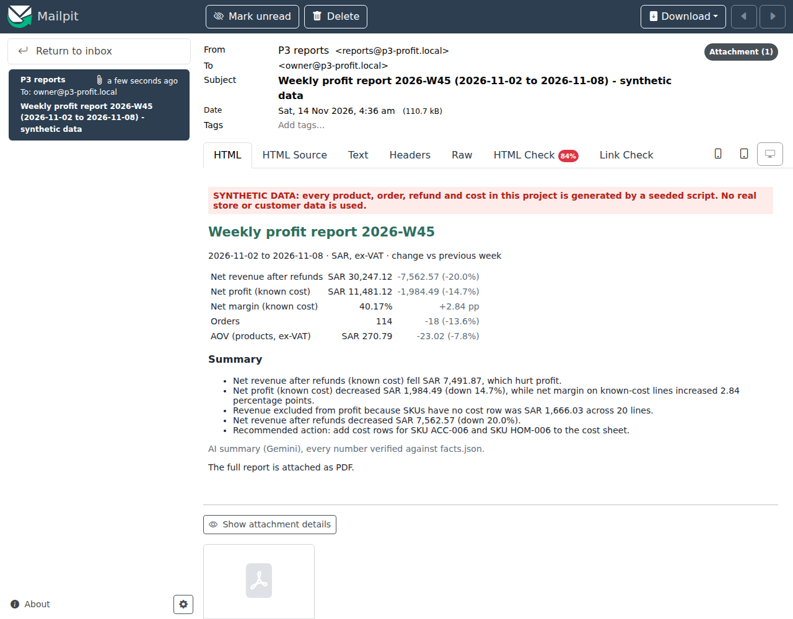

# n8n: weekly report schedule (synthetic data)

`workflows/weekly_report.json` runs **every Monday at 08:00 Asia/Riyadh**. It:
1. calls the P3 runner on the host: `POST /run` runs ingest → dbt build → report for the last full week;
2. if the run succeeded, downloads the PDF (`GET /files/<iso-week>/report.pdf`) and emails it to Mailpit, with the
   headline KPIs and the AI summary in the body;
3. otherwise sends an **alert email** with the error. The three failure cases are: the runner is unreachable, a
   pipeline step failed (the step is named), or the PDF download failed.

The workflow file contains **no secrets**. The runner token lives in an n8n credential named `P3 runner API`
(Header Auth), and SMTP in a credential named `Mailpit SMTP`.



## Setup

1. Start the services and the runner on the host (n8n runs in Docker and cannot run host Python):

   ```bash
   docker compose up -d n8n mailpit                      # n8n 127.0.0.1:5679, Mailpit UI 127.0.0.1:8025
   python3 scripts/append_env.py                         # adds RUNNER_API_TOKEN etc. to .env (append-only)
   .venv/bin/python -m p3 runner --with-mock-store       # 127.0.0.1:8770; or run `p3 serve` and drop the flag
   ```

   The container reaches the runner at `http://host.docker.internal:8770`. With Docker Desktop this works while the
   runner is bound to `127.0.0.1`. On a Linux Docker engine without Desktop, bind it to the Docker bridge gateway
   instead (`--host 172.17.0.1`). The runner refuses `0.0.0.0`.

2. Open http://localhost:5679 and create the owner account on first start.
3. **Credentials → Add credential**:
   - **Header Auth**, named `P3 runner API`: header name `Authorization`, value `Bearer <RUNNER_API_TOKEN from .env>`.
   - **SMTP**, named `Mailpit SMTP`: host `mailpit`, port `1025`, no user or password, SSL/TLS off.
4. **Workflows → Import from File** → `n8n/workflows/weekly_report.json`. If a node shows a credential warning,
   select the credential above in it.
5. Click **Execute workflow** to try it now, then open http://localhost:8025 to see the email.
   **Publish** (activate) the workflow to run it every Monday.

### Command-line alternative

The credential file holds the token: keep it outside the repo and delete it afterwards.

```bash
# cred.json:
# [{"id": "P3RunnerApi0001", "name": "P3 runner API", "type": "httpHeaderAuth",
#   "data": {"name": "Authorization", "value": "Bearer <RUNNER_API_TOKEN>"}},
#  {"id": "P3MailpitSmtp01", "name": "Mailpit SMTP", "type": "smtp",
#   "data": {"host": "mailpit", "port": 1025, "secure": false, "disableStartTls": true, "user": "", "password": ""}}]
docker cp cred.json p3-n8n:/tmp/cred.json && rm cred.json
docker exec p3-n8n n8n import:credentials --input=/tmp/cred.json
docker exec -u root p3-n8n rm /tmp/cred.json
docker cp n8n/workflows/weekly_report.json p3-n8n:/tmp/wf.json
docker exec p3-n8n n8n import:workflow --input=/tmp/wf.json
# run once now (a second task-broker port avoids a clash with the running n8n)
docker exec -e N8N_RUNNERS_BROKER_PORT=5690 p3-n8n n8n execute --id=p3WeeklyReport01
docker exec p3-n8n n8n publish:workflow --id=p3WeeklyReport01      # schedule it
```

## Verified

The flow was tested end to end against the real n8n 2.47.2 and Mailpit v1.32.0 containers:
- **success:** the email arrived with `report.pdf` attached, the KPIs and the verified AI summary;
- **runner stopped:** an alert email arrived ("runner unreachable", `ECONNREFUSED`);
- **store API down:** an alert email arrived naming the failed step (`ingest`).
